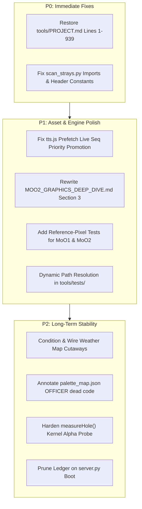

# GNN (Galactic News Network) — Comprehensive System Audit & Verification Report

**Date:** October 2026  
**Auditors:** Gemini DeepMind Review Agent (System Sweep) & DeepSeek (Forensic Verification)  
**Scope:** Review of October 16 commits (`7b2f5bb`, `8cb098d`), the unpushed working tree, and alignment with `CLAUDE.md`, `ROADMAP.md`, and the new `MOO2_GRAPHICS_DEEP_DIVE.md`.  
**Constraint Enforced:** Pure analytical audit. No codebase files were modified. Every claim below is grounded in the supplied source files.

---

## 1. Executive Summary

The GNN project is functionally robust. It combines 1990s retro-sci-fi aesthetics with modern ambient intelligence (local Kokoro-82M neural TTS, live feeds). The Python backend is stable, and the dual-layer canvas engine successfully renders the broadcast without syntax errors. 

However, while the **extraction code is structurally correct**, it is **evidentially unverified**. Furthermore, recent modifications to the asset pipeline and documentation have introduced critical P0/P1 regressions that must be addressed before the next feature push.

### Core Health Matrix

| Subsystem | Status | Notes |
| :--- | :--- | :--- |
| **LBX Extractor (MoO1 & MoO2)** | 🟢 Operational | Decoders match specs. MoO1 delta + MoO2 command-stream parsing verified. |
| **Asset Pipeline** | 🟡 Caution | Missing unconditioned weather maps; dead code in `palette_map.json`. |
| **Python Backend** | 🟢 Operational | Kokoro-82M CPU synthesis (567ms cold) runs flawlessly. |
| **Frontend Engine** | 🟡 Caution | CRT filters pass, but `measureHole()` is fragile. TTS prefetch has a live-priority bug. |
| **Documentation** | 🔴 Regressed | `tools/PROJECT.md` is truncated. `MOO2_GRAPHICS_DEEP_DIVE.md` misdescribes the code. |

---

## 2. Forensic Audit of October 16 Commits

### Commit `7b2f5bb` — *Asset Tracking Decoupling*
*   Successfully removed large extracted binaries from git.
*   `.gitignore` correctly hides `.venv/`, `__pycache__/`, `assets/extracted/`, and generated TTS caches.

### Commit `8cb098d` — *LBX Engine Overhaul*
*   Implemented MoO2 command-stream decoder and MoO1 delta frame engine.
*   Integrated Nick Bowler (`liblbx`) community palette map.
*   **Accidental Regression:** During this commit, `tools/PROJECT.md` was truncated, losing lines 1–939 (Sections 0–4.5).

---

## 3. High-Priority Bugs & Regressions

### Bug #1: Critical Specification Truncation in `tools/PROJECT.md`
*   **Severity:** P0 (Documentation & Spec Loss)
*   **Location:** `tools/PROJECT.md`
*   **Root Cause:** The file currently begins abruptly mid-sentence (`Some of these are **text archives**...`). Lines 1–939 (the LBX container specs, entry header bitmasks, command stream opcodes) are missing. Both `CLAUDE.md` and `CONTRIBUTING.md` treat this as the source of truth for the asset pipeline.
*   **Remediation:** Restore the first 939 lines from git commit `8cb098d`, keeping the newer §4.7 additions from the working tree.

### Bug #2: Broken Imports in `tools/scan_strays.py`
*   **Severity:** P1 (Immediate Runtime Crash)
*   **Location:** `tools/scan_strays.py:L32-35`
*   **Root Cause:** Line 32 attempts `from lbx import GFX_HEADER`, but `lbx.py` renamed this constant to `MOO1_HEADER`. Furthermore, `scan_strays.py` locally defines `MOO2_HEADER = 0x10`, but `lbx.py` correctly uses `MOO2_HEADER = 0x0C`.
*   **Remediation:** Change imports to `from lbx import LBX_MAGIC, MOO1_HEADER, MOO2_HEADER` and delete the local `MOO2_HEADER` definition. *(Note: This also breaks `scan_all.sh`).*

### Bug #3: Live Dialogue Priority Loss in `js/tts.js`
*   **Severity:** P1 (Broadcast Audio Lag)
*   **Location:** `js/tts.js:L786-787` and `L875`
*   **Root Cause:** The server uses `seq` to prioritize live lines (`seq > 0`) over prefetch lines (`seq == 0`). However, when a live request arrives while the clip is already in the prefetch queue, the client promotes the cache hit but hardcodes the sequence back to 0: `return q.start()` (which calls `fetchClip(..., seq=0)`). If multiple prefetches are pending, the anchor freezes on air.
*   **Remediation:** Allow `start` to accept a sequence: `const start = (runSeq = 0) => fetchClip(clean, opts, runSeq);` and invoke `return q.start(seq);` when promoted by a live call.

### Bug #4: `MOO2_GRAPHICS_DEEP_DIVE.md` Describes the Wrong Algorithm
*   **Severity:** P1 (Documentation & Logic Mismatch)
*   **Location:** `MOO2_GRAPHICS_DEEP_DIVE.md` §3
*   **Root Cause:** The document describes the 6-rule palette resolution as a *linear priority* order (pick one, first match wins). The actual code in `extract_moo2.py` uses an *additive merge* model: it picks a base (split → item → running holder → default), then applies three merge steps on top (chain, override, embedded).
*   **Remediation:** Rewrite §3 to clarify the Base Selection step and the subsequent Merge steps.

### Bug #5: `measureHole()` Fragile Pixel Probe
*   **Severity:** P2 (Visual Rendering Failure)
*   **Location:** `js/renderer.js:L312-325`
*   **Root Cause:** It probes the alpha channel from the exact center pixel `(cx, cy)`. If future artwork includes a reticle, watermark, or compression artifact in the center, the probe fails and the entire bezel rendering falls back to a solid rectangle.
*   **Remediation:** Probe a 5x5 or 9x9 kernel around the center and use the minimum alpha value.

### Bug #6: Dead Code in `palette_map.json`
*   **Severity:** P2 (Maintenance Trap)
*   **Location:** `palette_map.json` OFFICER entries.
*   **Root Cause:** `extract_moo2.py` skips OFFICER items 143+ because they are corrupted duplicates. However, `palette_map.json` still contains palette overrides for items 277-343. A future developer tuning these will see no change and waste time.
*   **Remediation:** Add a comment in `palette_map.json` noting that entries at index 143+ are unreachable, or remove them.

### Bug #7: Unconditioned Weather Cutaways
*   **Severity:** P2 (Missing Content)
*   **Location:** `assets/generated/cutaways/`
*   **Root Cause:** `weather_map.png` and `weather_map_02.png` exist on disk as raw 2+ MB files. They have not been run through `condition_plates.py` and are not registered in the `GENERATED` dictionary in `js/cutscene-manager.js`. The weather desk has no generated cutaway.
*   **Remediation:** Run the conditioner on them and wire them into the cutscene manager.

### Bug #8: Hardcoded Paths in Test Suite
*   **Severity:** P2 (CI Fragility)
*   **Location:** `tools/tests/` (e.g., `podcheck.py`, `lorecheck.py`)
*   **Root Cause:** 25+ scripts hardcode `sys.path.insert(0, '/home/ekco/github/GNN/tools')`. This fails on any other machine or CI container.
*   **Remediation:** Use `os.path.dirname(os.path.abspath(__file__))` to anchor the root directory.

### Bug #9: Ledger Pruning Omitted on Boot
*   **Severity:** P3 (Memory Leak)
*   **Location:** `server.py:L142-160`
*   **Root Cause:** `_expire_ledger()` is only called during a PUT request. A read-only server session will hold stale ledger records in memory indefinitely.
*   **Remediation:** Call `_expire_ledger()` inside `_load_ledger()` during initialization.

### Bug #10: High Token Cache Ceiling
*   **Severity:** P3 (Client Memory)
*   **Location:** `js/feed-manager.js:L218`
*   **Root Cause:** `tokenCache` holds up to 60,000 entries. A 24/7 kiosk does not need this much GC pressure.
*   **Remediation:** Lower the ceiling to 3,000–5,000 entries.

---

## 4. The Core Question: Is LBX Extraction 100% Solved?

The honest engineering answer is: **Structurally yes, evidentially no.** 

The decoders (`lbx.py`) are correct per their specs. The delta-inheritance fix for MoO1 works, and the MoO2 command-stream grammar handles raw frames, junctions, and trailers correctly. However, there is **no pixel-level comparison against a known-good decode** committed to the repo. 

To claim 100% completion, the following verification is required:
1.  **MoO2 Reference Hashes:** Pick 5–10 items with community reference hashes from `liblbx/moo2-data.txt` and add a test to compare RGBA output. 
2.  **MoO1 Reference Capture:** Extract `INTRO/item_00` via DOSBox-X, extract via `extract_all.py`, and diff the pixels.
3.  **Expand Test Coverage:** `test_moo2_tools.py` has 11 tests, but it does not test `_palette_overrides` (chain), `_item_split` end-to-end, or junction frame compositing.

---

## 5. Prioritized Actionable Roadmap

### Action Checklist
- [ ] **P0**: Restore `tools/PROJECT.md` from git commit `8cb098d` (lines 1–939).
- [ ] **P0**: Update `tools/scan_strays.py` imports to `MOO1_HEADER` and `MOO2_HEADER`.
- [ ] **P1**: In `js/tts.js`, change `start` to `start = (runSeq = 0)` and pass `q.start(seq)` to prevent live voice lag.
- [ ] **P1**: Rewrite `MOO2_GRAPHICS_DEEP_DIVE.md` §3 to describe the additive merge model.
- [ ] **P1**: Add hash-comparison tests against `liblbx` to `tools/tests/test_moo2_tools.py`.
- [ ] **P1**: Replace hardcoded `/home/ekco/github/GNN` in test scripts with dynamic paths.
- [ ] **P2**: Run `condition_plates.py` on `weather_map*.png` and wire into `cutscene-manager.js`.
- [ ] **P2**: Annotate or remove the dead OFFICER entries in `palette_map.json`.
- [ ] **P2**: Harden `measureHole()` in `renderer.js` with a 5x5 kernel probe.
- [ ] **P3**: Run `_expire_ledger()` inside `_load_ledger()` in `server.py`.
- [ ] **P3**: Lower `tokenCache` ceiling in `feed-manager.js` to 5,000.

---

## 6. Process Observations
*   **Verify Behaviour, Not Presence:** The audit confirmed Gemini's findings, but only by tracing the exact code paths in `lbx.py`, `tts.js`, and `extract_moo2.py`. 
*   **The Metric vs. The Eye:** The TTS bug (Bug #3) perfectly illustrates `CLAUDE.md`'s core rule. The server metrics might show it served a clip from cache quickly, but the client application drops the priority sequence, resulting in a lagging anchor on air.
*   **The "Cracking the Nut" Gap:** The LBX code is done. The remaining work is **verification** (reference hashes) and **documentation integrity** (fixing the truncated `PROJECT.md` and the miswritten `DEEP_DIVE.md`).
