<div align="center">

# GNN — Galactic News Network

**An unscripted, round-the-clock newscast simulation.**
Real-world news, read by a desk of *Master of Orion* aliens,
in a studio that keeps the games' archive as its footage library.
Twenty-four shows, ninety-six slots a day, never off the air.

[](#)
[](#)
[](#)
[](#)
[](#)
[](#)
[](#)

<a href="https://www.youtube.com/watch?v=iAQWnEE2qmM">
  
</a>

</div>

---

## Contents

- [What this is](#what-this-is)
- [Screenshots](#screenshots)
- [Quickstart](#quickstart)
- [How the broadcast is paced](#how-the-broadcast-is-paced)
- [Features](#features)
- [The channel as a channel](#the-channel-as-a-channel)
- [Architecture](#architecture)
- [The asset pipeline](#the-asset-pipeline)
- [The generated asset library](#the-generated-asset-library)
- [Verifying and rebuilding](#verifying-and-rebuilding)
- [Contributing](#contributing)
- [Credits](#credits)
- [Legal](#legal)

> Working on this? Start with **[`CONTRIBUTING.md`](CONTRIBUTING.md)**.
> **[`tools/PROJECT.md`](tools/PROJECT.md)** is the current
> source of truth for the whole asset pipeline — MoO1 and MoO2, both decoders,
> the palette map and its sources, and what remains to build.
> **[`CLAUDE.md`](CLAUDE.md)** covers the runtime and its load-bearing
> constraints.

---

## What this is

Most "retro news ticker" toys read a feed in a loop. This is a **channel**.

It has a rundown. It has dead air. The anchor finishes a story, lets it sit,
adds a line of his own, and throws to the next item. Every few stories the desk
goes away entirely for a commercial break that was storyboarded and voiced at
runtime. The transmitter fails on a schedule nobody published.

**The news the anchors read is real news.** Real headlines, real summaries,
real language. The 1993 aesthetic is the studio, the cutaways, the sound and
the anchors' faces — not a translation layer that turns a tariff ruling into a
sector trade accord. When a story about an election runs, the anchors say the
names on the wire. When a market moves, the ticker reports the actual number.
The MOO1 and MOO2 lore stays where it belongs: in its own show — the
*Imperial Historical Wire*, overnight — in the fictional commercials, and in
the faults and easter eggs a viewer finds by looking. It is never read after
a real story.

The channel is built on two sources.

**The archive.** Decoded from the original `.LBX` files for both games, the
catalog combines MoO1 and MoO2 graphics with game text, sound effects and
music assets. Nine MoO2 Smacker source videos can be decoded into frames;
33 reviewed segments are routed for runtime cutaways. `SOUND.LBX` effect
extraction and the MoO2 music (STREAM.LBX and the cinematics' soundtracks)
are extracted by their own tools. The local
build verified on 24 Oct 2026 holds 7,172 graphics items (MoO1 872 items /
4,025 frames, MoO2 6,300); `tools/verify_assets.py` prints the count for
whatever is on disk. The archive also
supplies the 75 news bulletins the original in-game anchor read and the
diplomacy the empires sent each other. It supplies the sound, the music and
the cutaway footage — stills and moving video — and the lore show's copy. The
freighter convoys and tactical plots are *composited at runtime* out of parts
the game shipped separately.

**The studio.** The set, the generated anchors and correspondents, the window
backdrops and the story cutaways are generated art, conditioned by
`tools/condition_plates.py` to the resolution they are drawn at and quantised
to 256 colours so they cut together with the decoded material rather than
sitting on top of it looking like a different decade. Every prompt that made
them is in [`assets/generated/Prompts/`](assets/generated/Prompts/),
regenerated from `tools/prompt_bridge.py`.

The game data itself is **not** in this repository, and is **required** to run
the station — the pipeline in [`tools/`](tools/) decodes it from your own
install. See [Quickstart](#quickstart) for the one-time setup and
[Legal](#legal) for the licensing reasoning.

---

## Screenshots

Every picture below is the running station, captured by
[`tools/capture_gallery.py`](tools/capture_gallery.py) — re-run it to refresh
them.

<div align="center">
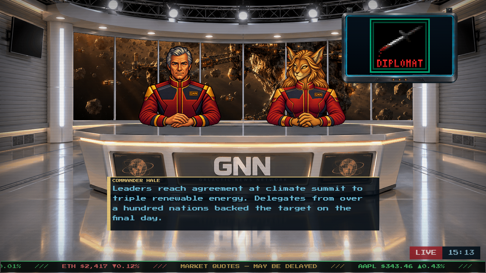
<br><em>Real headlines, read straight by the desk. The monitor carries the
story's icon; the crawl carries live market quotes.</em>
</div>

| Twenty-four shows on a 96-slot day | Weather every two hours |
| :---: | :---: |
| 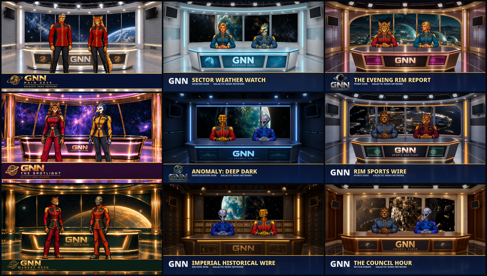 | 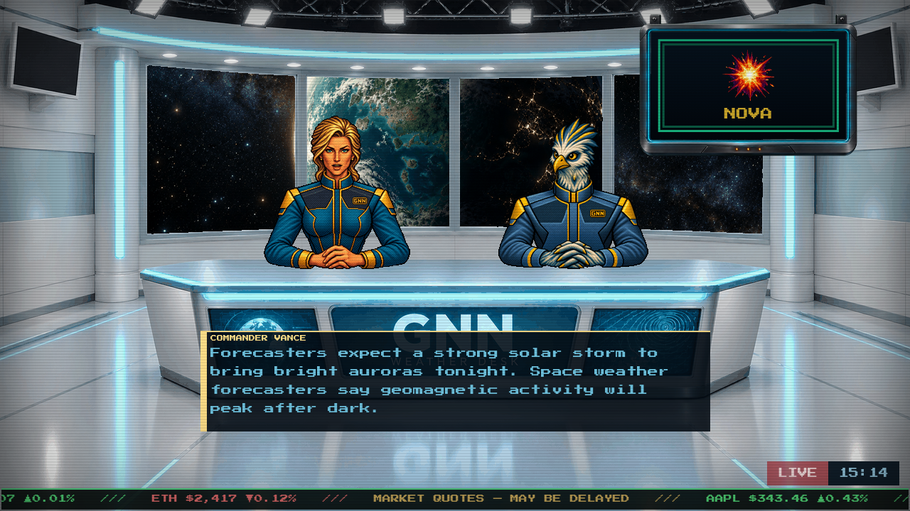 |
| Each show has its own set, pair and title card, and runs to the quarter hour on the viewer's clock. | Weather, sports, markets, debate, culture, overnight — and an archive hour for the lore. |

| Cutaway in the monitor | Full-screen footage |
| :---: | :---: |
| 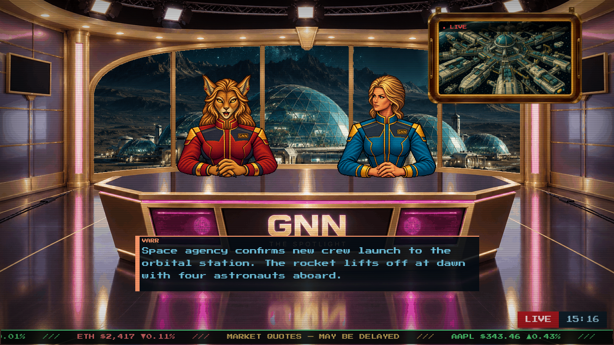 | 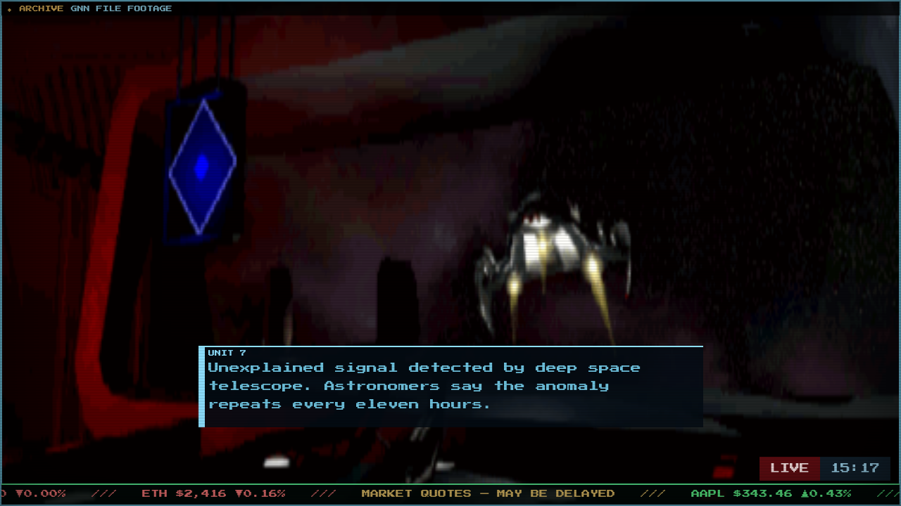 |
| Generated plates, archive composites, or… | …Master of Orion II's own cinematics, labelled as archive film. |

| Correspondent | Council Crossfire |
| :---: | :---: |
| 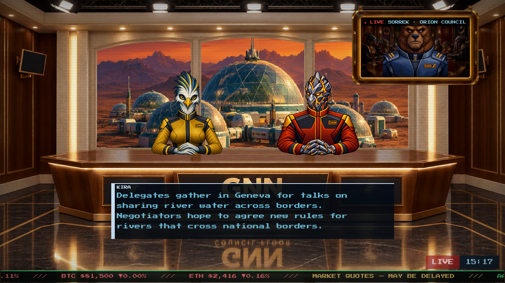 | 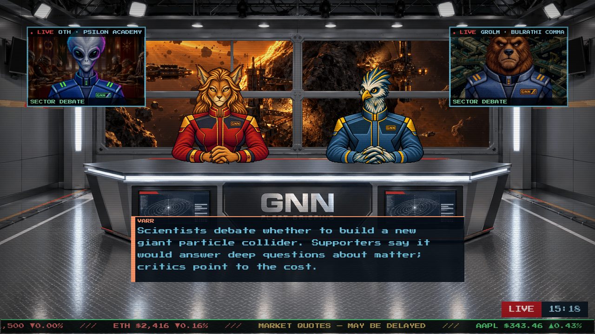 |
| Remotes come in through the monitor, in their own voice. | The debate block puts a guest in each monitor. |

| Galaxy Shop | Infomercial |
| :---: | :---: |
| 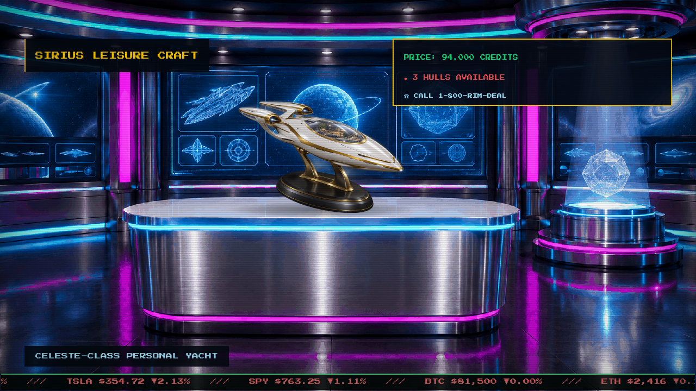 | 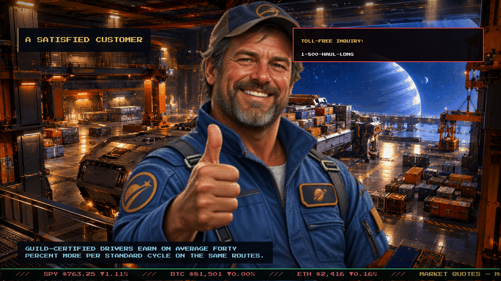 |
| Pods of two or three spots, each with its own announcer. | Lawyers, timeshares, and satisfied customers. |

| Imperial Research Exchange | Colonial Marine Corps |
| :---: | :---: |
| 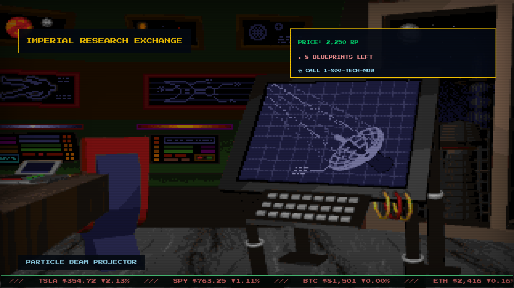 | 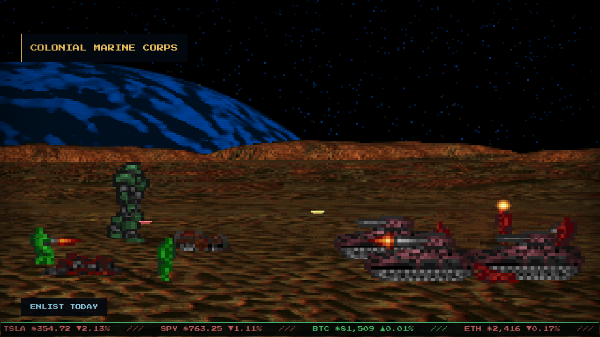 |
| Technology for research points, from MoO1's own lab screen. | A recruitment spot over a ground battle built from MoO2 troop cels. |

| Breaking news | Transmission faults |
| :---: | :---: |
| 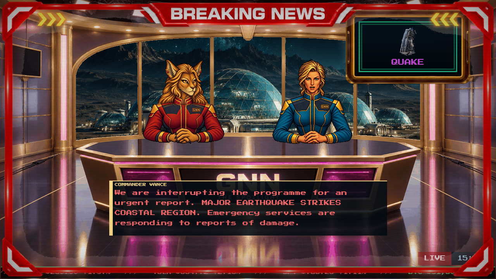 | 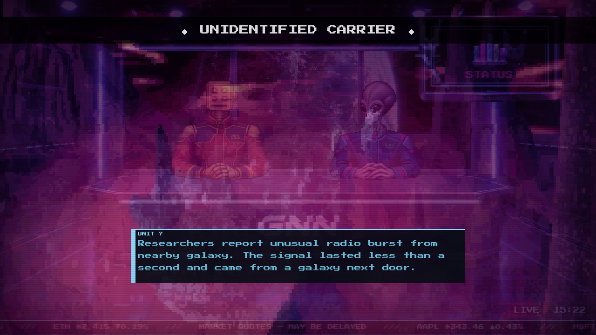 |
| The klaxon, the frame, and the desk interrupting itself. | Twenty-two faults, three rare events, thirty-five secrets. |

---

## Quickstart

```bash
git clone https://github.com/Ekco-S64QTN6/GNN.git
cd GNN

# Local voice engine & market proxy dependencies. Arch and other PEP 668 distros
# refuse system-wide pip, and Kokoro's phonemiser has no wheels for Python 3.14,
# so use Python 3.10-3.12 here.
python3.12 -m venv .venv
.venv/bin/pip install kokoro soundfile edge-tts curl_cffi
```

### Supply your own game files

The repo does not ship decoded game assets. Before the station can run, the
extraction pipeline has to decode them from a copy of the games you own. Copy
both games into the project so the tree looks like this:

```
Master of Orion 1/
├── data/          ← from Master of Orion 1
└── mastori2/      ← from Master of Orion 2
```

Both games are sold on GOG and Steam. See [Legal](#legal).

### Run the pipeline (once)

```bash
python3 tools/extract_all.py              # MoO1 graphics → assets/cutscenes/, icons, manifest
python3 tools/extract_text.py             # MoO1 text → assets/moo-strings.json
python3 tools/build_audio.py              # MoO1 SFX + MIDI → assets/audio/, audio-manifest.json
python3 tools/extract_moo2.py             # MoO2 graphics → assets/cutscenes/moo2/
python3 tools/extract_moo2_text.py        # MoO2 text → assets/text/moo2/
python3 tools/extract_sound_moo2.py       # MoO2 SFX → assets/audio/moo2/
python3 tools/extract_moo2_video.py       # MoO2 Smacker video → assets/cutscenes/moo2_video/
python3 tools/merge_moo2_manifests.py     # folds MoO2 graphics into assets/gfx-manifest.json
python3 tools/merge_moo2_text.py          # folds MoO2 text into assets/moo2-strings.json
python3 tools/build_audio.py              # re-runs to merge MoO2 audio into the manifest
```

**MoO2 music boundary:** `extract_sound_moo2.py` and `build_audio.py` automate
SOUND.LBX sound-effect extraction, profiling and manifest integration.
Complete decoding/rendering of raw MoO2 music sources is not automated yet:
`build_audio.py` only indexes OGG files already present in
`assets/audio/music/moo2/`. The reported 109-effect / 57-music-bed counts
describe a populated local extraction tree; counts may differ when ignored
music outputs are absent.

Elapsed time depends on the local game data and whether video frames need
to be decoded; rerunning only the stages whose inputs changed is faster than
a full rebuild. `assets/generated/` — the AI plates the studio is made of — is
already in the clone.

Verify before launching:

```bash
python3 tools/verify_assets.py
# Output from the local extraction tree, 24 Oct 2026:
# graphics : 7172 items, 9884 spot-checked frames, 417 gifs
# audio    : 109 effects, 5 stings, 57 music beds
# OK — every runtime asset resolves inside the project.
# Optional pre-rendered MoO2 OGGs can change the music-bed count.
```

### Launch

```bash
./broadcast.sh                # opens in its own window
```

`broadcast.sh` starts the server, opens the station in a dedicated window,
and takes it off air when that window closes. It is the way to watch the
channel — the audio path is cleaner than opening the page in a browser tab,
because the window grants autoplay and gets a straight audio route with no
browser UI in the middle.

Click once anywhere in the window — browsers require a gesture before any page
may make sound.

### Other ways to open it

```bash
./broadcast.sh --browser      # force the browser app window
./broadcast.sh --tab          # plain tab in your default browser
```

The first is a fallback for systems where the native window is unavailable.
The second is for the case where you want it inside your normal browsing
session, at the cost of the cleaner audio path.

### Going off air

Close the window. That is the whole procedure — `broadcast.sh` catches the
window closing, stops the server, and cleans up anything the run left behind.

If you started the station some other way:

```bash
./start.sh --bg     # run detached, logging to gnn-server.log
./stop.sh           # stop the server and anything the test harness left running
```

`stop.sh` shuts down the server by PID file, catches any stray one still
holding the port, and closes headless browsers the test harness started. It
matches those on the harness's own debugging port **and** on the process really
being a browser, so your own Chromium is never a target. `Ctrl-C` on a
foreground `start.sh` does the same thing.

**Requirements:** Python 3.8+ and a modern browser for the base server. For the
optional local voice engine and market proxy dependencies, use Python 3.10–3.12
(the quickstart creates a Python 3.12 virtual environment). No build step, no
bundler, no `node_modules`. The core broadcast runs offline, though the RSS
layer and the market ticker reach out to external endpoints.

---

## How the broadcast is paced

This is the part that makes it feel like television rather than a feed reader.
The rundown is generated as it plays — it is not a loop.

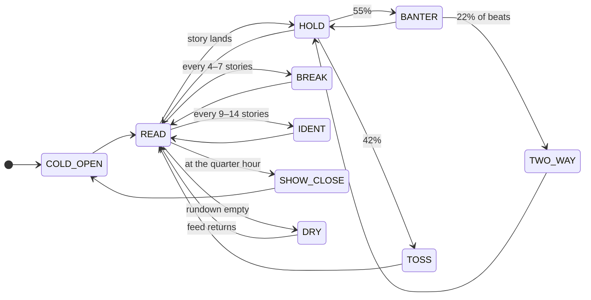

| Segment | What actually happens |
| :--- | :--- |
| **READ** | A live RSS story, read as real news. The teleprompter types to the *audio element's own playback position*, so the words appear as they are said rather than to an estimate that drifts. A cutaway fires a third of the way in. |
| **HOLD** | **A beat of air.** Voice silent, prompter holding the last line, the anchor's mouth shut, room tone carrying it — about a second between stories, a third of a second when one anchor answers another. Measured from the audio itself (`tools/tests/speechgaps.py`), not set by a timer and hoped for. |
| **BANTER** | Commentary on the story just read, or the two anchors talking to each other — a jab and a reply drawn from an asymmetric relationship table, each in its own voice. In real-world language, about the real story. |
| **TWO_WAY** | A remote. A correspondent appears live in the studio monitor; the anchor asks, the reporter answers in their own voice, the anchor thanks them. One portrait rather than a second set. |
| **TOSS** | The one-line handoff into the next item. |
| **BREAK** | A full commercial sequence — see below. |
| **IDENT** | Station identification. |
| **SHOW_CLOSE** | End of a show, on the quarter hour of the viewer's own clock. The lead signs off and names whoever sat with them, a bumper plays the next show's title card over its theme, and the next show opens on its own set with its own pair. |
| **DRY** | The feed went quiet. The anchor notices, and says so. |

**Lore has a show of its own.** The 75 `EVENTMSG.LBX` bulletins the original
in-game anchor read, 46 more written in the same voice, and the diplomatic
messages the empires sent each other in *Master of Orion II* are the rundown
of the *Imperial Historical Wire* (03:00–05:00). Every other show reads real
news, and only real news.

Breaking-news keywords pre-empt the rundown, sound the klaxon and put the
station's breaking-news frame up around the picture.

**Every spoken line goes through one queue.** Synthesis pre-empts itself, so
any line fired while someone was talking used to kill it, and which line
survived was a race. The director queues instead: one line at a time, the next
one synthesised while the current one plays, a quarter-second beat between
them, and the caption raised at the moment its own line starts.

**The schedule.** Ninety-six quarter-hour slots, read from the viewer's local
clock: *Galactic Morning Watch*, *Sector Midday Wire*, *Deep Space Economy*,
*Market Close*, *The Evening Rim Report*, *Council Crossfire*, *Rim Sports
Wire*, *Galactic Spotlight*, *The Night Desk*, *Anomaly: Deep Dark*, weather
at the top of every even hour — twenty-four shows in all, each with its own
set, pair, title card and theme. The weather desk reads real weather news and
real NOAA space-weather alerts.

---

## Features

<details open>
<summary><b>Pixel-perfect VGA studio</b></summary>

- The window is the broadcast, edge to edge. A 320×180 design grid rendered
  at 4× and fitted to the window, nearest-neighbour, with CRT scanlines.
- A generated studio with the desk built into it, and the back window
  **keyed out of the plate** so a backdrop can be composited behind the
  glass and changed per show block.
- Fourteen characters with their own voices, faces and opinions of one
  another. Anchors sit at the desk; everyone else arrives through the
  monitor as a remote.
- Everything inside the studio monitor is drawn to a **single viewport buffer**
  before being blitted, so faults roll, tear and desaturate the whole signal at
  once — the way a failing CRT would — rather than per element.

</details>

<details open>
<summary><b>Lip-sync gated on the voice</b></summary>

An `AnalyserNode` taps the voice bus. The generated cast have two mouth
states, so they flap on a syllable clock — but the clock is **gated on the
measured level**, which runs 0.002 to 1.000 with pauses between sentences
showing as runs below 0.10. Measured in the running app: the mouth is open
**1–2% of samples during silence and 56% during speech**.

Each `_speaking` plate is built as its hero with **only the mouth swapped
in** — 1.4–3.1% of the plate differs, one blob on the mouth — so a flap
cannot move anything else. During dead air they blink.

</details>

<details open>
<summary><b>Zero-cloud neural voice</b></summary>

The voice runs **on this machine**. `/api/tts` drives
[Kokoro-82M](https://huggingface.co/hexgrad/Kokoro-82M) (Apache-2.0) in
process — 17 English voices, 24 kHz, about 7x faster than real time on CPU
alone, no GPU required and nothing leaving the machine.

Every clip is **level-matched and delivered lossless**. Each clip is matched
to -21 LUFS / -3 dBTP, with gentle compression ahead of the gain so the
limiter never has to do the levelling. `python3 tools/voice_audition.py`
renders every voice the running engine offers back to back, so the selector
can be chosen by ear.

Clips are **fetched before they play**, not streamed from a live URL, which
removes the one-to-four second synthesis lag between a segment starting and
its voice arriving, and lets the whole commercial break be synthesised the
moment it is assembled.

</details>

<details open>
<summary><b>Synthesized B-roll</b></summary>

*Master of Orion* never shipped a shot of a freighter convoy crossing a colony
skyline at dusk. It shipped the skyline, the freighter, the nebula wash and
the tactical readout plates. This builds the shot.

Nine recipes — `convoy · tactical · survey · council · interview · industry ·
anomaly · deepfield · groundwar` — layer backdrops, sprites and HUD chrome on a
320×200 buffer with independent per-layer motion models and depth-scaled
parallax. Routing is driven by the story's own keywords. Two runs of the same
recipe never look alike.

`groundwar` puts *Master of Orion II*'s troop animations — infantry, tanks and
power armour — on a planet surface as two armies trading fire. It shows
soldiers dying, so it illustrates in-universe stories only, never real ones.

Some stories get **moving footage** instead: *Master of Orion II*'s own
cinematics, full-screen, labelled as archive film.

The `interview` recipe is a special case: it composes the three specific
EMBASSY item groups (room, ambassador, player representative) at the scale
they were drawn at, so they line up exactly as they do in-game. Its constants
are tunable in `tools/interview_tuner.html`.

</details>

<details open>
<summary><b>Commercial breaks, not bumpers</b></summary>

A break is a **pod of two or three spots**, 40 to 60 seconds, each spot a
storyboarded sequence — hook, product hero, spec plate, tag card, legal card —
read by its own announcer, with its own composited scene and sound design, and
a cut or a dissolve between shots. The station's ident opens it in a voice of
its own.

The rotation: the **GNN Galaxy Shop** (21 products on a showroom pedestal,
price and stock on screen), **overnight infomercials** (14, from class-action
lawyers to timeshares, with testimonial portraits from satisfied customers),
the station's **named sponsors** (Orion Heavy Industries, Sirius Hyper-Drive
Systems, Betelgeuse Pharmaceuticals, Rigel Agricultural Cartel, Darlok
Security Solutions — each closing on its crest), **network promos** for the
channel's own shows, **Council public notices**, and procedural spots for
brands made up on the spot. Built from the archive itself: the **Imperial
Research Exchange** sells technology for research points on *Master of
Orion*'s own lab screen, the **Orion Salvage Auction** sells *Master of Orion
II*'s 212 applied-research pictures as lots, **Honest Gnolam's Starships** puts
a different archive hull on the showroom pad every shot, and the **Colonial
Marine Corps** recruits over a ground battle.

Most spots are staged on generated sets — 27 of them, from a submerged ocean
villa to a foundry floor; archive stills are the occasional throwback.

> *Draconis Cybernetics presents the Annihilator-Class programme.*
> *Rated for 26 standard years of continuous operation.*
> *Draconis Cybernetics. Built for the long dark.*
> <sub>Warranty ends at the terminator line.</sub>

</details>

<details open>
<summary><b>The full audio bank</b></summary>

The latest recorded populated local manifest lists 109 effects (41 MoO1,
68 MoO2), profiled offline by duration, spectral brightness, attack and
sustain, then bucketed into 13 roles — `click blip tick thud beep chirp zap
servo sweep blast siren alarm drone rumble` — so the director asks for *a
kind of noise*, not an index. The same recorded output indexed 57 music beds:
40 MoO1 MIDI renders and 17 pre-existing MoO2 cinematic/stream OGGs. Counts
depend on the local extraction outputs. `build_audio.py` integrates MoO2
effects when `assets/audio/moo2/manifest.json` exists and indexes MoO2 OGGs
already present under `assets/audio/music/moo2/`; it does not decode or
render raw MoO2 music sources.

The graph is a real console: separate SFX, music and voice buses into a
station bus, through a bit-crush glitch stage, into a master compressor.

</details>

<details open>
<summary><b>Anomalies and easter eggs</b></summary>

Twenty-two faults: snow, macroblocking, a frozen frame, the colour guns
drifting out of convergence, the picture flipping, a hum bar crawling up the
tube, colour bars with line-up tone, the station's own test card, a "please
stand by" slate, and other channels bleeding through the carrier. None repeats
within four, and the news on air nudges which come up — a hurricane makes the
signal snowy. Three rare events run on a clock of their own, tens of minutes
apart, and are worth staying up for.

The secrets are undocumented on purpose. There are thirty-five. The studio
monitor rewards persistence, the anchors reward curiosity, the keyboard
remembers 1986 and knows every species by name, some minutes of the day sound
different, and what you find stays found.

</details>

---

## The channel as a channel

GNN does not have a transport bar. It has a broadcast. There is no
play/pause button, no mute toggle, no voice picker visible on screen — the
window is the television and the television does not have controls on its
face.

Three things respond to the viewer:

- **The canvas is clickable.** The studio monitor and the anchor's face
  each do something. Discovered by trying.
- **The keyboard is listening.** Some sequences are remembered. Some words
  are recognised.
- **`Esc` or `S` opens station configuration.** Feed list, breaking
  bulletin injection, the unlisted transmissions the station has logged, and
  the **secrets board** — each secret found by name, the rest as blanks with
  a hint.

A debugging telemetry line is off by default and enabled through the
configuration panel.

---

## Architecture

No framework, no build step. Seventeen plain-script modules, each with one job,
plus one generated table.

```
js/
├── asset-registry.js      manifest queries — nothing else hard-codes a path
├── audio-engine.js        sfx/music/voice buses, ducking, glitch DSP
├── tts.js                 neural voice client + lip-sync analyser
├── pronounce-kokoro.js    generated: pronunciation checked against the voice itself
├── script-writer.js       banter, ad copy, ticker segments, chyrons
├── scene-compositor.js    layered B-roll synthesis (9 recipes, 10 motion models)
├── cutscene-manager.js    cutaways + the commercial break sequencer
├── broadcast-director.js  the rundown state machine — owns the clock
├── text-engine.js         teleprompter + lower-third chyron
├── glitch-engine.js       anomalies + easter eggs
├── animator.js            viseme lip-sync + globe cel control
├── ticker-manager.js      seamless market crawl
├── icon-manager.js        over-the-shoulder icon matcher
├── feed-manager.js        RSS ingestion, sanitising, importance scoring
├── cast.js                who the anchors are: voices, tics, what they
│                          think of one another
├── logger.js              browser-side console and transcript logger
├── renderer.js            viewport buffer, layer stack, CRT post-processing
└── main.js                bootstrap, UI wiring, frame loop
```

**Layer stack.** Everything is composited into an offscreen buffer the size of
the window and post-processed as one signal:

```
1  the set                              ─┐
2  the anchors, lip-synced               │  drawn to the
3  the desk, in front of them            │  viewport buffer,
4  over-the-shoulder monitor             │  then rolled / torn /
5  cutaway or commercial break           │  desaturated / ghosted
6  story caption, the lower third        │  as one picture
7  LIVE tag and clock                    │
8  market crawl                         ─┘
9  alert border + glitch artefacts
```

**The one rule:** no module outside `asset-registry.js` may name an asset path.
Everything asks the registry for *a kind of thing*. That is what makes the
whole library reachable instead of a handful of hard-coded items. The registry
handles both games — MoO2 entries carry `source: 'moo2'` and their paths
resolve under `assets/cutscenes/moo2/`, and MoO2 strings are merged in from
`assets/moo2-strings.json` alongside the MoO1 pool.

---

## The asset pipeline

Both games ship their graphics in an **LBX container**, but the frame encodings
are completely different, and `tools/lbx.py` implements both.

```
u16 count | u32 0x0000FEAD | u16 type | (count+1) × u32 item offsets
```

MoO1 pads its header to nothing (the first item starts right after the offset
table); MoO2 pads to `0x800`.

### MoO1 — column-major, delta frames

```
u8 kind (1 = keyframe, 0 = delta over the previous frame)
  per column:
    0xFF                        column unchanged
    u8 mode | u8 seglen         seglen bytes of run data follow

    inside those seglen bytes, repeated until they run out:
      u8 pixcount | u8 skip | pixcount bytes of payload
        skip = transparent rows before this run, measured from the END of the
               previous run in this column — a gap, not an absolute y
        mode 0x80 = RLE  (v ≥ 0xE0 → v−0xDF copies of the next byte, max 32)
        mode 0x00 = raw
```

**Two rules that had to be right, and were wrong for a long time:**

- A delta column describes **only the pixels that changed**. Pixels inside a
  re-encoded column that the encoder did not touch stay as they were on the
  previous frame. Do not clear the column before applying the runs — that
  turns every unchanged pixel transparent, which is what made INTRO scenes
  show vertical stripes through the sky.
- A pixel whose new value is `0` has been **erased** by the encoder. It writes
  through as transparent. A pixel the encoder did not touch is written by
  `skip`, not by writing 0. The two are different operations and only the
  encoder knows which is which.

Getting the second rule wrong is what caused the missile-trail bug: the
decoder skipped writes of `0`, so pixels the encoder had erased kept the
missile from the frame before, and it smeared from its launch point to its
current position.

### MoO2 — row-major, self-contained per frame

```
01 00        u16 frame marker (must equal 1)
<initial_y>  u16 initial Y cursor
  then a stream of:
    u16 length      if > 0: u16 x_advance, `length` pixels, pad if odd
    u16 length      if = 0: u16 y_advance; 1000 means end of frame
```

Raw frames (flag `0x0100`) are `w × h` palette indices, row-major, padded to a
4-byte boundary. Every frame is drawn over the previous frame's pixels, and
the visible area restarts every `chunk` frames (header byte 9) — whatever the
`0x2000` "junction" flag says. That rule is what makes the decoder match
liblbx's reference renders (`tools/tests/moo2_reference.py`).

The whole MoO2 format, with the palette mechanisms and the archive-by-archive
findings, is written up for anyone working with these files in
[`MOO2_GRAPHICS_DEEP_DIVE.md`](MOO2_GRAPHICS_DEEP_DIVE.md).

### Text, Audio, and Video

- **Text:** MoO2 text is stored in NUL-delimited string tables inside `.LBX`
  archives and `.EXE` binaries. `extract_moo2_text.py` pulls them out and
  `merge_moo2_text.py` filters them into the same pools used by the MoO1
  strings (bulletins, leaders, topics, vocab).
- **Audio:** MoO2 SFX are already native WAVs embedded in `SOUND.LBX` and are
  extracted byte-for-byte by `extract_sound_moo2.py`. The music is a mix of
  raw WAV streams in `STREAM.LBX` and audio ripped from Smacker cinematics
  (`INTRO.LBX`, `*FIN.LBX`) by `ffmpeg` and transcoded to OGG.
- **Video:** Smacker cinematics are decoded to PNG frame sequences by
  `extract_moo2_video.py`.

### Palettes

MoO2 archives do not all use the same palette, and the assignment is not
derivable from the files themselves. `tools/palette_map.json` encodes it, with
four layers: archive-level base palette, per-item palette, per-item override,
and item-range splits/override chains.

The values come from two community sources, attributed in
[`tools/PROJECT.md`](tools/PROJECT.md):

- **Nick Bowler's `liblbx`** (`git.draconx.ca/gitweb/liblbx.git`) —
  `doc/txt/moo2-data.txt` assigns palettes to about 14 archives and families,
  with item-range splits and override chains; `tests/moo2data.at` holds MD5s
  of 14 reference renders, all of which our decoder reproduces.
- **Wolverine's graphics-format write-up** — the header, flags, internal
  palette layout and the SHIPS palette-holder mechanism.

Neither source covers the whole library. The rest — COUNCIL, CMBTSFX,
OFFICER, DIPLOMAT, RACES, EVENTS, BEAMS and others — were worked out from the
files and checked by eye; the deep dive marks which is which.

### Entry points

```bash
python3 tools/extract_all.py              # MoO1 graphics
python3 tools/extract_moo2.py             # MoO2 graphics
python3 tools/extract_moo2_text.py        # MoO2 NUL-delimited strings
python3 tools/extract_sound_moo2.py       # MoO2 SFX (native WAVs)
python3 tools/extract_moo2_video.py       # MoO2 Smacker video
python3 tools/extract_music_moo2.py       # MoO2 music (STREAM.LBX + video soundtracks) → OGG
python3 tools/build_audio.py              # MoO1 + MoO2 SFX & music → manifest
python3 tools/extract_text.py             # MoO1 text and vocabulary
python3 tools/merge_moo2_manifests.py     # folds MoO2 graphics into gfx-manifest.json
python3 tools/merge_moo2_text.py          # folds MoO2 text into moo2-strings.json
python3 tools/condition_plates.py         # AI plates → 256-colour plates
python3 tools/prompt_bridge.py            # prompts for art MOO1 cannot supply
```

Each item is measured and given a `role` (`fullscreen · panel · portrait ·
sprite · chrome · strip · blank`) plus `coverage`, `lum`, `colors`, a `hero`
frame index and a `noise` score. That metadata is the whole reason the engine
can use the library safely.

> **On the scrambled items.** A handful were authored against screen palettes
> that live in the game executable, not in any archive. They decode
> structurally correct but chromatically scrambled. They are not discarded —
> the manifest scores them, the compositor keeps them out of ordinary footage,
> and `glitch-engine.js` uses them deliberately as transmission interference.

Full format notes and the manifest schema: **[`assets/README.md`](assets/README.md)**.

---

## The generated asset library

Everything else the studio is made of. Each directory is conditioned by
`tools/condition_plates.py`, which reads the frame size out of `renderer.js`
so a change of resolution cannot leave a plate behind.

| Directory | What lives there |
| :--- | :--- |
| `anchors/` | Fourteen characters. `desk_hero`, `speaking`, `listening`, `listening_flip` per species. |
| `set/` | Ten studio plates. Window panes are keyed out and recorded in `layout.json` so backdrops composite behind the glass. |
| `cutaways/` | Story plates routed by subject keyword. |
| `backdrops/` | Exterior views composited into the window opening, four moods across four times of day. |
| `correspondents/` | Monitor portraits for the two-way and debate beats. |
| `logos/` | Show and desk logos. |
| `icons/` | Over-the-shoulder story icons — 22 subjects; the original *Master of Orion* event icons appear now and then as a throwback. |
| `overlays/` | The breaking-news frame and the monitor bezels (gunmetal, and brass for the warmer sets). |
| `titlecards/` | Full-bleed show bumpers. |
| `infomercials/`, `products/`, `sponsors/`, `testimonials/` | Commercial break art. |
| `Prompts/` | The prompt files that made all of the above. `_OUTSTANDING.md` lists anything still to generate. |

---

## Verifying and rebuilding

The app needs `assets/generated/` (shipped in the repo) plus decoded game
assets from the pipeline in [Quickstart](#quickstart). Once both are in place:

```bash
python3 tools/verify_assets.py
# Output from the local extraction tree, 24 Oct 2026:
# graphics : 7172 items, 9884 spot-checked frames, 417 gifs
# audio    : 109 effects, 5 stings, 57 music beds
# The counts are whatever your extraction produced; optional MoO2 OGGs also
# affect the music-bed count.
# OK — every runtime asset resolves inside the project.
```

### Diagnostics

Several tools exist for tuning specific pieces without touching the shipped
assets:

| Tool | Purpose |
| :--- | :--- |
| `tools/scene_review.html` | Preview every recipe and cutscene item; flag assets to exclude. |
| `tools/interview_tuner.html` | Slider tuning for the EMBASSY interview composition. |
| `tools/studio_review.html` | Desk-line tuning for the ten studio sets. |
| `tools/commercial_review.html` | Previewing and tuning product placement in commercial breaks. |
| `tools/palette_compare.py` | Render one MoO2 sprite against every FONTS palette. |
| `tools/moo2_probe.py` | Byte-level LBX inspection. |
| `tools/drive.py` | Headless broadcast harness — runs the station, samples the director, screenshots each segment. |
| `tools/capture_gallery.py` | Re-shoots every screenshot in this README from the running station. |
| `tools/tests/speechgaps.py` | Times the silence between spoken lines and catches any line cut off. |
| `tools/pronounce_kokoro.py` | Checks every pronunciation rule against the voice; `--say WORD` shows how a word will sound. |
| `trailer/` | Records takes off air and cuts the trailer. |

```bash
python3 tools/drive.py 120 .shot
# states seen: {'READ': 161, 'HOLD': 33, 'BANTER': 30, 'TWO_WAY': 24, 'BREAK': 23}
# console errors: 0, exceptions: 0
```

Full tool list, testing discipline and current work status:
[`tools/PROJECT.md`](tools/PROJECT.md) and [`CLAUDE.md`](CLAUDE.md).

---

## Contributing

Read [`CONTRIBUTING.md`](CONTRIBUTING.md) before changing anything — how to
work on the station without breaking it while it is on air, and the rules
learned from the agents who worked on it before. `CLAUDE.md` is the source
of truth for current state; `docs/ROADMAP.md` is what comes next.

## Credits

- ***Master of Orion 1*** (1993) and ***Master of Orion 2*** (1996) —
  SimTex / MicroProse. All artwork, sound effects and music originate there.
- **LBX format documentation and MoO2 palette assignments** —
  Nick Bowler's [`liblbx`](https://git.draconx.ca/gitweb/liblbx.git) project,
  particularly `doc/txt/moo2-data.txt` and its reference renders, and
  Wolverine's graphics-format write-up
  ([reposted 2008](https://masteroforion2.blogspot.com/2008/04/moo2-graphics.html)).
- **Speech** — [Kokoro-82M](https://huggingface.co/hexgrad/Kokoro-82M) (Apache-2.0),
  run locally. Microsoft neural voices via [`edge-tts`](https://github.com/rany2/edge-tts)
  remain as a fallback.
- **Music rendering** — FluidSynth with the FluidR3 GM soundfont. Smacker
  video decoding via `ffmpeg`.
- **Type** — *Press Start 2P* and *Outfit* via Google Fonts.
- **News** — 26 RSS feeds tagged by topic, fetched by the server proxy, and
  [NOAA SWPC](https://www.swpc.noaa.gov/) space-weather alerts for the weather desk.
- **Local fallback** — `/api/localnews` parses the newest daily digest off
  disk so the channel still has a rundown when the proxy is rate-limited.

---

## Legal

**This is a non-commercial portfolio project. No copyright infringement is
intended.**

*Master of Orion* is a trademark of its respective owners; the game, its
artwork, its music and its sound effects are © 1993–1996 SimTex Software and
MicroProse Software, and all rights in them remain with their current holders.
This project is not affiliated with, authorised by, endorsed by or sponsored by
SimTex, MicroProse, Atari, Wargaming, or any successor rights holder.

**No game data is distributed here in any form.**

- The game's `.LBX` archives are not included in this repository.
- The decoded PNGs, GIFs, WAVs, OGGs and manifests that the extraction
  pipeline produces from those archives are also **not** included. They are
  gitignored deliberately. Anyone running this project supplies their own
  copy of the games and runs the pipeline to produce their own assets.
- What *is* included under `assets/generated/` is **AI-generated art**
  (the studio set, the anchors, the cutscenes, the commercial plates) made
  from the prompts in `assets/generated/Prompts/`. It is not derived from
  any SimTex or MicroProse asset.

The tools in `tools/` are clean-room format readers written to interoperate
with a copy of the games you already own. Running them requires you to supply
your own legally obtained copy of *Master of Orion 1* and *Master of Orion 2*
(both are sold on GOG and Steam).

If you represent a rights holder and would prefer any part of this repository
be taken down, please open an issue and it will be removed promptly.

Third-party names, marks and feed content referenced by the live RSS layer
belong to their respective owners and appear only as transient news data.

The **original code** in this repository — the engine, the extractors, the
broadcast director and the compositor — is released under the MIT License.
```
