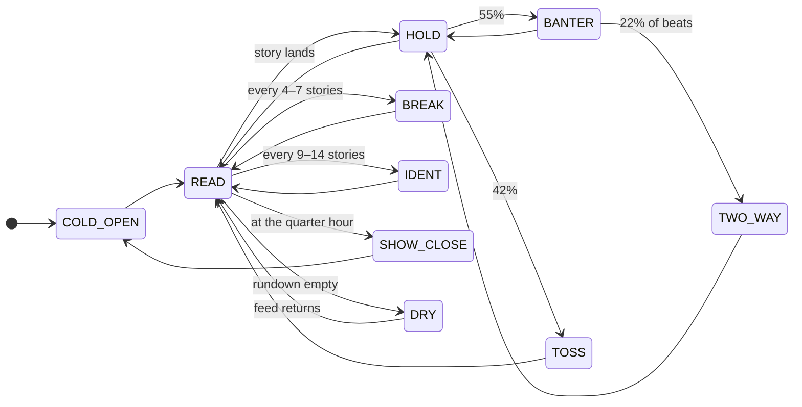

# The broadcast

How the channel is paced, what it airs, and how it behaves as a channel. The code behind it is in [ARCHITECTURE.md](ARCHITECTURE.md).

## How the broadcast is paced

This is the part that makes it feel like television rather than a feed reader.
The rundown is generated as it plays — it is not a loop.

| Segment | What actually happens |
| :--- | :--- |
| **READ** | A live RSS story, read as real news. The teleprompter types to the *audio element's own playback position*, so the words appear as they are said rather than to an estimate that drifts. A cutaway fires a third of the way in. |
| **HOLD** | **A beat of air.** Voice silent, prompter holding the last line, the anchor's mouth shut, room tone carrying it — about a second between stories, a third of a second when one anchor answers another. Measured from the audio itself (`tools/tests/speechgaps.py`), not set by a timer and hoped for. |
| **BANTER** | Commentary on the story just read, or the two anchors talking to each other — a jab and a reply drawn from an asymmetric relationship table, each in its own voice. In real-world language, about the real story. |
| **TWO_WAY** | A remote. A correspondent appears live in the studio monitor; the anchor asks, the reporter answers in their own voice, the anchor thanks them. One portrait rather than a second set. |
| **TOSS** | The one-line handoff into the next item. |
| **BREAK** | A full commercial sequence — see below. |
| **IDENT** | Station identification. |
| **SHOW_CLOSE** | End of a show, on the quarter hour of the viewer's own clock. The lead signs off and names whoever sat with them, a bumper plays the next show's title card over its theme, and the next show opens on its own set with its own pair. |
| **DRY** | The feed went quiet. The anchor notices, and says so. |

**Lore has a show of its own.** The 75 `EVENTMSG.LBX` bulletins the original
in-game anchor read, 46 more written in the same voice, and the diplomatic
messages the empires sent each other in *Master of Orion II* are the rundown
of the *Imperial Historical Wire* (03:00–05:00). Every other show reads real
news, and only real news.

Breaking-news keywords pre-empt the rundown, sound the klaxon and put the
station's breaking-news frame up around the picture.

**Every spoken line goes through one queue.** Synthesis pre-empts itself, so
any line fired while someone was talking used to kill it, and which line
survived was a race. The director queues instead: one line at a time, the next
one synthesised while the current one plays, a quarter-second beat between
them, and the caption raised at the moment its own line starts.

**The schedule.** Ninety-six quarter-hour slots, read from the viewer's local
clock: *Galactic Morning Watch*, *Sector Midday Wire*, *Deep Space Economy*,
*Market Close*, *The Evening Rim Report*, *Council Crossfire*, *Rim Sports
Wire*, *Galactic Spotlight*, *The Night Desk*, *Anomaly: Deep Dark*, weather
at the top of every even hour — twenty-four shows in all, each with its own
set, pair, title card and theme. The weather desk reads real weather news and
real NOAA space-weather alerts.

## Features

<b>Pixel-perfect VGA studio</b>

- The window is the broadcast, edge to edge. A 320×180 design grid rendered
  at 4× and fitted to the window, nearest-neighbour, with CRT scanlines.
- A generated studio with the desk built into it, and the back window
  **keyed out of the plate** so a backdrop can be composited behind the
  glass and changed per show block.
- Fourteen characters with their own voices, faces and opinions of one
  another. Anchors sit at the desk; everyone else arrives through the
  monitor as a remote.
- Everything inside the studio monitor is drawn to a **single viewport buffer**
  before being blitted, so faults roll, tear and desaturate the whole signal at
  once — the way a failing CRT would — rather than per element.

<b>Lip-sync gated on the voice</b>

An `AnalyserNode` taps the voice bus. The generated cast have two mouth
states, so they flap on a syllable clock — but the clock is **gated on the
measured level**, which runs 0.002 to 1.000 with pauses between sentences
showing as runs below 0.10. Measured in the running app: the mouth is open
**1–2% of samples during silence and 56% during speech**.

Each `_speaking` plate is built as its hero with **only the mouth swapped
in** — 1.4–3.1% of the plate differs, one blob on the mouth — so a flap
cannot move anything else. During dead air they blink.

<b>Zero-cloud neural voice</b>

The voice runs **on this machine**. `/api/tts` drives
[Kokoro-82M](https://huggingface.co/hexgrad/Kokoro-82M) (Apache-2.0) in
process — 17 English voices, 24 kHz, about 7x faster than real time on CPU
alone, no GPU required and nothing leaving the machine.

Every clip is **level-matched and delivered lossless**. Each clip is matched
to -21 LUFS / -3 dBTP, with gentle compression ahead of the gain so the
limiter never has to do the levelling. `python3 tools/voice_audition.py`
renders every voice the running engine offers back to back, so the selector
can be chosen by ear.

Clips are **fetched before they play**, not streamed from a live URL, which
removes the one-to-four second synthesis lag between a segment starting and
its voice arriving, and lets the whole commercial break be synthesised the
moment it is assembled.

<b>Synthesized B-roll</b>

*Master of Orion* never shipped a shot of a freighter convoy crossing a colony
skyline at dusk. It shipped the skyline, the freighter, the nebula wash and
the tactical readout plates. This builds the shot.

Nine recipes — `convoy · tactical · survey · council · interview · industry ·
anomaly · deepfield · groundwar` — layer backdrops, sprites and HUD chrome on a
320×200 buffer with independent per-layer motion models and depth-scaled
parallax. Routing is driven by the story's own keywords. Two runs of the same
recipe never look alike.

`groundwar` puts *Master of Orion II*'s troop animations — infantry, tanks and
power armour — on a planet surface as two armies trading fire. It shows
soldiers dying, so it illustrates in-universe stories only, never real ones.

Some stories get **moving footage** instead: *Master of Orion II*'s own
cinematics, full-screen, labelled as archive film.

The `interview` recipe is a special case: it composes the three specific
EMBASSY item groups (room, ambassador, player representative) at the scale
they were drawn at, so they line up exactly as they do in-game. Its constants
are tunable in `tools/interview_tuner.html`.

<b>Commercial breaks, not bumpers</b>

A break is a **pod of two or three spots**, 40 to 60 seconds, each spot a
storyboarded sequence — hook, product hero, spec plate, tag card, legal card —
read by its own announcer, with its own composited scene and sound design, and
a cut or a dissolve between shots. The station's ident opens it in a voice of
its own.

The rotation: the **GNN Galaxy Shop** (21 products on a showroom pedestal,
price and stock on screen), **overnight infomercials** (14, from class-action
lawyers to timeshares, with testimonial portraits from satisfied customers),
the station's **named sponsors** (Orion Heavy Industries, Sirius Hyper-Drive
Systems, Betelgeuse Pharmaceuticals, Rigel Agricultural Cartel, Darlok
Security Solutions — each closing on its crest), **network promos** for the
channel's own shows, **Council public notices**, and procedural spots for
brands made up on the spot. Built from the archive itself: the **Imperial
Research Exchange** sells technology for research points on *Master of
Orion*'s own lab screen, the **Orion Salvage Auction** sells *Master of Orion
II*'s 212 applied-research pictures as lots, **Honest Gnolam's Starships** puts
a different archive hull on the showroom pad every shot, and the **Colonial
Marine Corps** recruits over a ground battle.

Most spots are staged on generated sets — 27 of them, from a submerged ocean
villa to a foundry floor; archive stills are the occasional throwback.

> *Draconis Cybernetics presents the Annihilator-Class programme.*
> *Rated for 26 standard years of continuous operation.*
> *Draconis Cybernetics. Built for the long dark.*
> Warranty ends at the terminator line.

<b>The full audio bank</b>

The latest recorded populated local manifest lists 109 effects (41 MoO1,
68 MoO2), profiled offline by duration, spectral brightness, attack and
sustain, then bucketed into 13 roles — `click blip tick thud beep chirp zap
servo sweep blast siren alarm drone rumble` — so the director asks for *a
kind of noise*, not an index. The same recorded output indexed 57 music beds:
40 MoO1 MIDI renders and 17 pre-existing MoO2 cinematic/stream OGGs. Counts
depend on the local extraction outputs. `build_audio.py` integrates MoO2
effects when `assets/audio/moo2/manifest.json` exists and indexes MoO2 OGGs
already present under `assets/audio/music/moo2/`; it does not decode or
render raw MoO2 music sources.

The graph is a real console: separate SFX, music and voice buses into a
station bus, through a bit-crush glitch stage, into a master compressor.

<b>Anomalies and easter eggs</b>

Twenty-two faults: snow, macroblocking, a frozen frame, the colour guns
drifting out of convergence, the picture flipping, a hum bar crawling up the
tube, colour bars with line-up tone, the station's own test card, a "please
stand by" slate, and other channels bleeding through the carrier. None repeats
within four, and the news on air nudges which come up — a hurricane makes the
signal snowy. Three rare events run on a clock of their own, tens of minutes
apart, and are worth staying up for.

The secrets are undocumented on purpose. There are thirty-five. The studio
monitor rewards persistence, the anchors reward curiosity, the keyboard
remembers 1986 and knows every species by name, some minutes of the day sound
different, and what you find stays found.

## The channel as a channel

GNN does not have a transport bar. It has a broadcast. There is no
play/pause button, no mute toggle, no voice picker visible on screen — the
window is the television and the television does not have controls on its
face.

Three things respond to the viewer:

- **The canvas is clickable.** The studio monitor and the anchor's face
  each do something. Discovered by trying.
- **The keyboard is listening.** Some sequences are remembered. Some words
  are recognised.
- **`Esc` or `S` opens station configuration.** Feed list, breaking
  bulletin injection, the unlisted transmissions the station has logged, and
  the **secrets board** — each secret found by name, the rest as blanks with
  a hint.

A debugging telemetry line is off by default and enabled through the
configuration panel.
